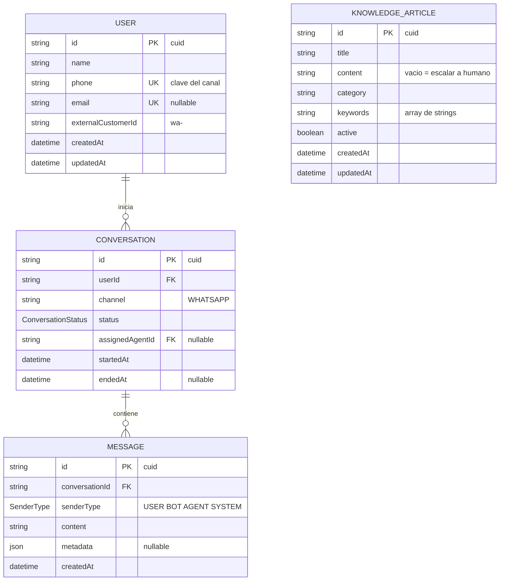
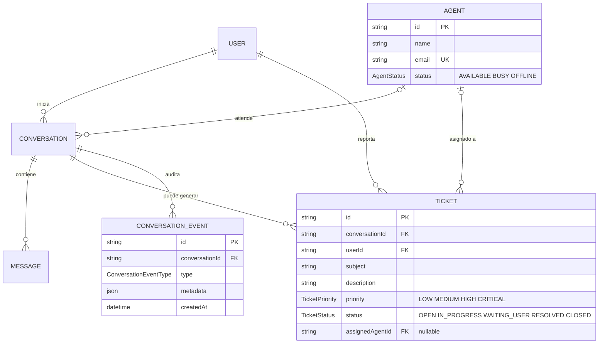
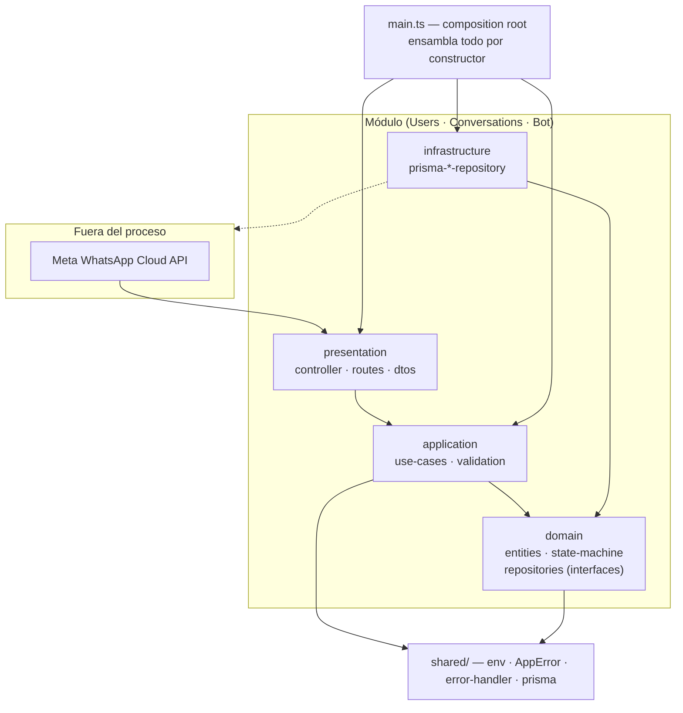
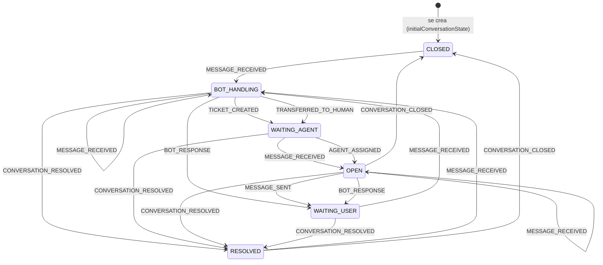

# ChatBot de Soporte Técnico — Primera versión de la solución

> Guion de la exposición · miércoles 23 · ~10 minutos · 12 diapositivas
> Los **Anexos A, B y C** no forman parte de los 10 minutos. Están como respaldo para
> preguntas del jurado. Si tu plantilla no renderiza Mermaid, en cada diapositiva
> tienes escrita la descripción textual del diagrama.

---

## 0. Cómo usar este guion

Cada diapositiva trae tres bloques:

- **Contenido** — lo que va en la lámina (pocos bullets, legibles desde atrás).
- **Qué decir** — 2 a 4 frases de guía. No es un texto para leer, es para saber
  en qué orden y con qué argumento contar cada lámina.
- **⏱ Tiempo** — la suma da 9:45, dejando ~1 minuto de margen.

Diagrama de tiempos: `0:15 · 1:00 · 1:00 · 1:00 · 1:00 · 1:00 · 0:30 · 0:45 · 1:15 · 1:00 · 1:15 · 0:45`

---

# 1. Portada

**⏱ 0:15**

### Contenido

> # ChatBot de Soporte Técnico
> ## Primera versión de la solución
>
> Bounded context: **Soporte Técnico conversacional**
>
> Canal: WhatsApp Business Cloud API
> Base: Node.js 20 · TypeScript · Express 5 · PostgreSQL + Prisma
> Arquitectura: Clean Architecture modular (Ports & Adapters)

### Qué decir

Presentamos la primera versión de un backend que atiende consultas de soporte técnico
por WhatsApp. El punto de entrada de la charla es el **bounded context**: de dónde sale
el sistema y qué le corresponde resolver. Después veremos el modelo de datos, la
arquitectura, los algoritmos de resolución y qué queda pendiente.

---

# 2. Bounded Context

**⏱ 1:00**

### Contenido

**Contexto núcleo — Soporte Técnico conversacional**

| | Contexto | Responsabilidad | Estado |
|---|---|---|---|
| **Core** | **Conversaciones** | Ciclo de vida de la atención, mensajes, máquina de estados | ✔ implementado |
| Supporting | Base de Conocimiento | Responder consultas repetitivas sin humano | ✔ implementado |
| Supporting | Identidad de Clientes | El teléfono es la clave; alta y actualización | ✔ implementado |
| Supporting | Tickets | Registrar y dar seguimiento al traspaso | ⚠ solo diseño |
| Supporting | Agentes | Disponibilidad y asignación de la cola | ⚠ solo diseño |
| Generic | Canal WhatsApp | Adaptador de entrada/salida, intercambiable | ✔ implementado |
| Generic | Notificaciones | Avisos al usuario y al agente | ⚠ no iniciado |

**Lenguaje ubicuo**
`Cliente` · `Conversación` · `Mensaje` · `Ticket` · `Agente` · `Artículo de Conocimiento` · `Evento de Conversación`

**Frontera declarada — lo que el dominio todavía NO hace**
- No crea tickets ni asigna agentes (el traspaso solo cambia el estado).
- No tiene memoria entre turnos: cada mensaje se resuelve aislado.
- No es un sistema de gestión documental, solo responde sobre lo que está cargado.

### Qué decir

El contexto es *atención de soporte conversacional*. El **núcleo** es el ciclo de vida de
la conversación, porque todo lo demás cuelga de él: si no hay conversación no hay
mensajes, ni ticket, ni agente. La base de conocimiento y la identidad de clientes son
**de soporte**: ayudan pero no definen el negocio. WhatsApp es **genérico**: es un
adaptador, mañana podría ser Telegram con el mismo dominio.

Delimitamos la frontera de entrada. Hoy el bot resuelve o se rinde y cambia el estado a
"esperando agente". **No crea ticket ni asigna a nadie.** Es una decisión consciente: el
dominio ya está modelado, falta la operación. También decimos que no hay memoria entre
turnos, que es la limitación que más se va a notar.

*Motivación de negocio:* el cliente tiene ~250 reportes y un volumen alto de consultas
repetitivas (imprimir factura, error de conexión, clave). Automatizar el primer nivel es
el caso de uso.

---

# 3. ER — Núcleo implementado

**⏱ 1:00**

### Contenido



**Decisiones del modelo que vale la pena explicar**

- `phone` es **único**: es la llave natural del canal, no se necesita un login.
- `status` es un **enum de 6 valores** (`ConversationStatus`), no un string libre.
- `content = ""` en `KnowledgeArticle` es una **decisión de diseño**: vacío significa
  "esto no lo responde el bot, escala a humano". Ver diapositiva 9.
- Índices que **sí se usan hoy**: `users(phone)` unique, `conversations(userId)`,
  `conversations(status)`, `messages(conversationId, createdAt)`.
- `KnowledgeArticle` es una **tabla plana a propósito**: la consulta de conocimiento se resuelve
  recorriendo artículos activos, no con joins. Ver el límite en la diapositiva 10.

*Si no renderiza Mermaid:* `User 1—N Conversation 1—N Message` en cascada. Un cliente
tiene muchas conversaciones, una conversación muchos mensajes, y al borrar una
conversación se van sus mensajes. `KnowledgeArticle` no se relaciona con nadie: es
contenido de solo lectura que el bot consulta.

### Qué decir

Este es el modelo que **hoy tiene código**. Tres entidades conectadas en cascada más la
base de conocimiento, que está aparte a propósito.

Lo que más importa aquí es que `phone` es único. En un canal de mensajería el teléfono
**es** la identidad; no hay usuarios anónimos ni contraseñas. Eso simplifica todo el
modelo de identidad.

El segundo punto es `KnowledgeArticle` sin relaciones: es contenido plano que el bot
consulta. Y ojo con el `content` vacío — no es un dato faltante, es una **señal
explícita** que revisamos en la diapositiva 9.

La cascada también es una decisión: si se borra una conversación, sus mensajes dejan de
tener sentido, así que se van con ella.

---

# 4. ER — Visión completa de la v1

**⏱ 1:00**

### Contenido



**Estado de las 7 entidades**

| # | Entidad | En esta versión | Nota |
|---|---|---|---|
| 1 | `User` | ✔ Código | 4 casos de uso + repositorio |
| 2 | `Conversation` | ✔ Código | 5 casos de uso + máquina de estados |
| 3 | `Message` | ✔ Código | Se escribe desde el repositorio de conversación |
| 4 | `KnowledgeArticle` | ✔ Código | 3 artículos ficticios de ejemplo en el seed |
| 5 | `Ticket` | ⚠ Diseño | **Ningún código lo crea** |
| 6 | `Agent` | ⚠ Diseño | **Ningún código lo asigna** |
| 7 | `ConversationEvent` | ⚠ Diseño | **La tabla de auditoría nunca se escribe** |

- **6 enums**: `SenderType`, `ConversationStatus`, `TicketStatus`, `TicketPriority`, `AgentStatus`, `ConversationEventType`
- **15 índices** declarados · 2 restricciones `UNIQUE`
- **Borrado en cascada** en las Conversations → Messages/Tickets/Events
  (`Cascade`) · **`SetNull`** al borrar un agente, para no perder el histórico
  · **`Restrict`** al borrar un usuario con tickets

### Qué decir

Esta es la **visión completa** del modelo, y quiero ser claro con la diferencia entre las
dos láminas: esto no es lo que corre, es lo que está **diseñado**.

Tres entidades están implementadas y cuatro no. `Ticket` y `Agent` existen con sus enums,
sus índices y sus relaciones, pero **ninguna línea de código los crea**. Lo mismo con
`ConversationEvent`: la tabla de auditoría está declarada y nunca se escribe, así que hoy
no tenemos trazabilidad de eventos, solo mensajes.

Decimos esto a propósito: el esquema está adelantado al código. Es una decisión —el
dominio primero, la operación después— pero es un deuda que está anotada y priorizada
en la diapositiva 11.

Un detalle del borrado: si se elimina un agente, las conversaciones y tickets quedan con
el agente en `null` en vez de desaparecer. Preferimos perder la asignación y conservar
el histórico. Si se elimina un usuario que tiene tickets, el `Restrict` lo bloquea.

---

# 5. Arquitectura

**⏱ 1:00**

### Contenido



**Reglas que se cumplen (verificadas en el código)**

1. `domain` **no importa nada** de Prisma, de Express ni de otro módulo.
2. `presentation → application → domain`; `infrastructure` **depende de** `domain`, no al revés.
3. **Ningún módulo importa a otro módulo.** `conversations` llega a `users` por un
   puerto *duck-typed* (`findUser`), no por un import.
4. Composition root **único**: `src/main.ts`. No hay contenedor de DI, todo se inyecta
   por constructor.
5. Prisma aparece **solo** en `infrastructure/` y en `main.ts`.

**Por qué `src/bot/` vive fuera de `src/modules/`**
Porque es el único componente que conoce `users` **y** `conversations` a la vez: es un
adaptador de integración, no un módulo de negocio. Adentro mantiene las mismas 4 capas
y suma `botpress/` para el proveedor externo.

**Stack**: Node 20 · TypeScript 7 `strict` · ESM puro · Express 5 · Prisma 7 con
`@prisma/adapter-pg` · Vitest 5 · helmet · cors · dotenv

### Qué decir

Cada módulo es una **Clean Architecture de 4 capas**. La flecha importante es
`infrastructure → domain`: el repositorio de Prisma implementa la interfaz que vive en
`domain`, y la dirección de la dependencia se invierte respecto a lo habitual. Eso es lo
que permite probar el dominio sin base de datos.

La regla que más valor da es la tercera: **los módulos no se importan entre sí**.
`conversations` necesita verificar que el usuario exista, y no importa a `users`: recibe
una función. Por eso se puede mover un módulo entero sin tocar el otro.

`main.ts` es el único lugar donde se ensambla todo. No hay contenedor de inyección, es
DI a mano. Suena viejo, pero para 10 casos de uso es más legible que cualquier framework.

Y `src/bot/` está fuera de `modules/` por una razón concreta: es el único que conoce dos
módulos a la vez.

---

# 6. Dominio — Máquina de estados de la conversación

**⏱ 1:00**

### Contenido



- **6 estados**: `OPEN` · `BOT_HANDLING` · `WAITING_USER` · `WAITING_AGENT` · `RESOLVED` · `CLOSED`
- **9 eventos** de dominio · **18 de 54 aristas** definidas
- **Transición inválida → `InvalidTransitionError` → HTTP 409**
- Solo **3 de 9** eventos se emiten hoy: `MESSAGE_RECEIVED`, `BOT_RESPONSE`, `TRANSFERRED_TO_HUMAN`

**"Puerta cerrada"** — la conversación nace en `CLOSED`; solo `MESSAGE_RECEIVED` la revive.

```
Mensaje con respuesta:  CLOSED → BOT_HANDLING → WAITING_USER
Mensaje sin respuesta:  CLOSED → BOT_HANDLING → WAITING_AGENT
```

### Qué decir

Este es el corazón del dominio: una **máquina de estados de 6 estados y 9 eventos**, con
la tabla de transiciones declarada en un solo objeto.

De 54 combinaciones posibles hay 18 permitidas. Cualquier otra lanza un error de
dominio que sale como **409**. Es la garantía de que no se puede, por ejemplo, responder
con el bot una conversación ya cerrada.

La decisión de la que más nos gusta: **la conversación nace en `CLOSED`**. Parece raro, y
lo es a propósito — la llamamos "puerta cerrada". Nadie puede escribir en una conversación
que no ha empezado; el primer mensaje del usuario es lo que la abre. Evita el
`BOT_RESPONSE` sobre una conversación fantasma.

Y un detalle de tests: hay un test que **recorre la tabla entera y verifica cada
transición**. Si mañana agregamos una transición nueva, el test la cubre solo, sin
escribir una línea. Lo_listener-explico rápido porque es una decisión de diseño, no un
detalle.

### Qué decir

*(Si sobra tiempo, mostrar el bug de la arista faltante con una línea y seguir.)*

`WAITING_AGENT → OPEN` por `MESSAGE_RECEIVED` existe, pero desde `OPEN` **no** se permite
`TRANSFERRED_TO_HUMAN`. Es decir: si el cliente escribe otra vez después de haber
escalado, la conversación vuelve a `OPEN` y el bot ya no puede volver a escalarla.
Produce un 409 que se traduce en 500 en el webhook. Está identificado y es prioridad
*Must* en la diapositiva 11.

---

# 7. Estructura de folders

**⏱ 0:30**

### Contenido

```
src/
├── main.ts                    ← composition root: ensambla todo
├── app.ts                     ← factory Express (helmet, cors, 1 MB, /api/health)
│
├── shared/                    ← kernel común
│   ├── config/env.ts
│   ├── errors/{app.error,error-handler}.ts
│   ├── http/request.ts        ← requireString / optionalString
│   └── infrastructure/prisma.ts
│
├── modules/                   ← MÓDULOS DE NEGOCIO
│   ├── users/                 ✔
│   │   ├── domain/{entities/user, repositories/user-repository}
│   │   ├── application/{use-cases/×4, validation}
│   │   ├── infrastructure/prisma-user-repository
│   │   ├── presentation/{controller, routes, dtos}
│   │   ├── tests/use-cases.test.ts
│   │   └── index.ts           ← wiring
│   │
│   ├── conversations/         ✔
│   │   ├── domain/{entities/conversation, repositories/…, state-machine}
│   │   ├── application/{use-cases/×5, validation}
│   │   ├── infrastructure/prisma-conversation-repository
│   │   ├── presentation/{controller, routes, dtos}
│   │   ├── tests/{state-machine,use-cases}.test.ts
│   │   └── index.ts           ← wiring
│   │
│   ├── tickets/               ⚠ andamiaje vacío (.gitkeep)
│   ├── agents/                ⚠ andamiaje vacío
│   ├── messages/              ⚠ andamiaje vacío
│   ├── knowledge-base/        ⚠ andamiaje vacío
│   ├── integrations/          ⚠ andamiaje vacío
│   └── chatbot/tools/         ⚠ andamiaje vacío
│
├── bot/                       ← ADAPTADOR (fuera de modules: cruza 2 módulos)
│   ├── presentation/whatsapp-webhook.ts
│   ├── application/process-incoming-message.ts
│   ├── domain/{brain,knowledge,whatsapp}
│   ├── infrastructure/{prisma-knowledge-repository,whatsapp-sender}
│   ├── botpress/index.ts
│   ├── tests/bot.test.ts
│   └── index.ts               ← wiring
│
└── generated/prisma/          ← autogenerado (gitignored)

prisma/{schema.prisma, seed.ts, migrations/0001_init}
```

### Qué decir

La estructura es la de **módulos**: cada carpeta de `modules/` es una unidad de negocio
completa, con sus 4 capas. Dos están implementadas — `users` y `conversations` — y seis
existen solo como andamiaje, con la estructura de carpetas ya montada.

Esa es la decisión: **crear el andamiaje completo desde el principio**, aunque esté
vacío. Cualquiera que abra el repo ve que la intención es modular y que `tickets` no es
un olvido.

`src/bot/` está fuera de `modules/` por lo que dijimos: cruza dos módulos, es un
adaptador de integración. Y `generated/` se gitignora porque Prisma la regenera en el
`postinstall`.

---

# 8. Convenciones

**⏱ 0:45**

### Contenido

| Ámbito | Convención | Ejemplo |
|---|---|---|
| **Archivos** | `kebab-case`, siempre | `handle-non-text-event.ts` |
| **Clases / tipos** | `PascalCase`, interfaces **sin** prefijo `I` | `ConversationRepository` |
| **Funciones / vars** | `camelCase` | `selectBestMatch` |
| **Constantes** | `SCREAMING_SNAKE_CASE` | `INITIAL_STATUS`, `MAX_MESSAGE_LENGTH` |
| **Imports ESM** | Extensión `.js` **obligatoria** en rutas relativas | `from "./entities/conversation.js"` |
| **Exports** | Solo nombrados, nunca `default` | — |
| **Puertos** | Interface en `domain/repositories/`, implementación `prisma-*` en `infrastructure/` | — |
| **Dependencias** | Constructor con `private readonly` | `new SendMessageUseCase(repo)` |
| **Errores** | `AppError` base → `NotFoundError` (404) · `ValidationError` (422) · `InvalidTransitionError` (409) | — |
| **Respuesta de error** | `{ error: { code, message, details? } }` | `{"error":{"code":"NOT_FOUND",...}}` |
| **Validación** | Sin librerías. Dos capas: transporte (`requireString`) + aplicación (`validation.ts`) | — |
| **Mensajes al usuario** | Siempre en **español** | `"Conversación no encontrada"` |
| **Logging** | JSON estructurado a stdout, sin librería | `{"level":"error","msg":"..."}` |
| **Enums de dominio** | Unión de literales, no `enum` de TS | `"CLOSED" \| "OPEN" \| ...` |
| **tsconfig** | `strict` + `noUncheckedIndexedAccess` + `noImplicitOverride` | — |
| **Tests** | Colocados en `<módulo>/tests/`, excluidos del build | `state-machine.test.ts` |
| **Fakes** | Fábricas escritas a mano con overrides, sin librería de mocks | `makeRepository()` |

**Regla de oro**: *la dirección de la dependencia no se negocia.* Si `domain` importa
Prisma, la arquitectura se cayó.

### Qué decir

Las convenciones no son un capricho, son **decisiones para que el código se lea igual
en cualquier parte**. Tres que vale la pena destacar.

**Uno**: ESM puro, con extensión `.js` en cada import relativo. Parece molesto hasta que
se compila, y entonces explica por qué.

**Dos**: la validación es **a mano, sin librerías**, y en dos capas —el transporte
comprueba el tipo, la aplicación comprueba la regla de negocio—. Es defensa en
profundidad, y significa que un caso de uso es seguro se llame desde donde se llame.

**Tres**: todos los mensajes al usuario en español y los identificadores en inglés.

Si preguntan por qué no hay linter: es un pendiente real, está en la lista de *Should*
de la diapositiva 11. Hoy la consistencia la mantienen el typecheck estricto y el
criterio del equipo.

---

# 9. Algoritmo — Cómo se resuelve la respuesta

**⏱ 1:15**

### Contenido

**Paso 1 — Cadena de fuentes con cortocircuito** (`domain/knowledge.ts`)

```
1. StaticKnowledgeBase            en memoria, 4 artículos  ─┐
2. PrismaKnowledgeBaseRepository  SELECT … WHERE active    ─┼─ ¿respondió? ─ sí → devolver
3. BotpressBrain (opcional)       HTTP webhook externo     ─┘                  no ↓
                                                                              siguiente
```

**Paso 2 — Puntuar cada artículo** (`scoreMatch`)

```ts
function normalize(v: string): string {
  return v.toLowerCase().normalize("NFD").replace(/[\u0300-\u036f]/g, "");
}   // → "atención" === "atencion"

function tokens(q: string): string[] {
  return normalize(q).split(/\s+/).filter((t) => t.length >= 3);
}   // descarta "de", "a", "y", "el"

export function scoreMatch(query: string, article: KnowledgeArticle): number {
  const q = normalize(query);
  const title = normalize(article.title);
  let score = 0;

  for (const keyword of article.keywords)
    if (q.includes(normalize(keyword))) score += 3;      // +3 keyword contenida

  if (title.length > 0 && q.includes(title)) score += 2; // +2 título completo

  for (const token of tokens(query))
    if (normalize(article.content).includes(token)) score += 1;  // +1 token en contenido

  return score;
}
```

**Paso 3 — Elegir el ganador** (`selectBestMatch`)
Barrido lineal. Se queda con el **mayor puntaje**; el umbral efectivo es **≥ 1**.
Empates los gana el **primer artículo** del arreglo (comparación estricta `>`).

**Paso 4 — El centinela del escalamiento**
El artículo `static-agent` tiene **5 palabras clave** y `content: ""`.
Gana el puntaje → `selectBestMatch` ve el contenido vacío → devuelve `null`
→ la cadena cae a la siguiente fuente → si nadie responde, **escala a humano**.
Contenido vacío = "esto no lo responde el bot". Es un contrato, y hay un test que lo fija.

### Qué decir

El algoritmo tiene tres pasos y lo importante es que no es un modelo: es **determinista y
auditable**. Para soporte técnico eso es una ventaja, no una limitación: podemos
explicar por qué el bot respondió lo que respondió.

**Paso 1**: tres fuentes, de la más barata a la más cara, con **cortocircuito**. Si los
4 artículos estáticos responden, no se toca la base de datos ni se hace la llamada HTTP
a Botpress. Es la optimización principal y es gratis.

**Paso 2**: el puntaje es fijo y legible. Tres puntos por palabra clave, dos si el
título aparece completo, uno por cada token que aparece en el contenido. Dos detalles
que parecen menores y no lo son: la **normalización NFD quita acentos**, así que
"atención" encuentra "atencion" — imprescindible en español — y el **filtro de tokens
de 3 caracteres** descarta "de", "a", "y" sin necesidad de un listado de palabras
vacías.

**Paso 3**: barrido lineal, gana el mayor puntaje, y el umbral efectivo es 1. Lo digo
explícitamente porque es un punto débil: **una sola coincidencia basta para responder**.

**Paso 4**, que es el más elegante: el traspaso a humano no es una regla con `if`. Es un
artículo con palabras clave y **contenido vacío**. Si gana el puntaje pero no hay
contenido, la función devuelve `null` y la cadena continúa. El comportamiento sale de
la estructura de datos. Y hay un test que fija ese contrato, así que nadie lo rompe sin
darse cuenta.

---

# 10. Algoritmo — Optimización y límites

**⏱ 1:00**

### Contenido

**Lo que sí está optimizado**

| Optimización | Dónde | Ganancia |
|---|---|---|
| **Cortocircuito entre fuentes** | `knowledge.ts` | Evita query y HTTP si la KB estática responde |
| **Pre-filtro en SQL** `active: true` | `prisma-knowledge-repository` | No baja artículos inactivos a memoria |
| **`findUnique` sobre `phone` único** | `prisma-user-repository` | El puerto mapea 1:1 al índice único |
| **Índice `(conversationId, createdAt)`** | `schema.prisma` | Historial ordenado sin `filesort` |
| **Mapeo anti-corrupción** `toDomain()` | Ambos repositorios | Prisma no se filtra al dominio |
| **Fail-fast de la transición** | 3 casos de uso | Transición inválida aborta **antes** de escribir |
| **Degradación a modo MOCK** | `bot/index.ts` | El sistema arranca y opera sin credenciales |

**Lo que NO está optimizado — y su consecuencia**

| Límite | Consecuencia medible |
|---|---|
| **Sin caché de la KB** | Se lee la tabla completa de artículos **en cada mensaje** y se puntúa en JS |
| **Sin umbral de confianza** | Un único token coincidente produce una respuesta |
| **Sin límites de palabra** | El keyword `"hi"` matchea dentro de *"chico"*, *"historia"*, *"muchacho"* |
| `normalize(content)` re-calculado por token | Normaliza el mismo texto N veces por consulta |
| Índice `(category, active)` declarado y **sin uso** | El índice existe para un filtro que nadie hace |
| **Sin transacciones** | `addMessage` + `update` son 2 viajes; una caída entre ellos deja mensaje huérfano |
| **Sin timeouts ni reintentos** | Un Botpress colgado cuelga el webhook de WhatsApp |
| **Sin paginación** | No existe listar conversaciones ni artículos |

**Propuesta para la v2 — en este orden**

1. **Caché en memoria con TTL** + invalidación por `updatedAt` al arrancar: el 90 % de
   la ganancia con el 20 % del esfuerzo.
2. **Índice invertido `keyword → artículos`** en vez de recorrer la lista completa: pasa
   el puntaje de O(n) a O(k).
3. **Umbral de confianza real** (ej. ≥ 4) y exigir coincidencia por palabra completa con
   regex `\b`, lo que elimina los falsos positivos por subcadena.
4. **Mover el scoring a PostgreSQL** con `tsvector` + trigramas cuando el corpus crezca.

### Qué decir

Esta lámina es la más honesta de la presentación, y es la que mejor se defiende.

Lo de la izquierda está pensado: el cortocircuito, el pre-filtro en SQL en vez de en
memoria, el mapeo anti-corrupción, y el **fail-fast**, que me gusta especialmente —
calculamos la transición de estado **antes** de escribir, así que una transición inválida
aborta sin dejar basura.

Lo de la derecha son los límites reales. El más importante: **no hay caché**. Cada
mensaje que entra lee la tabla completa de artículos y la puntúa en JavaScript. Con 3
artículos de ejemplo no se nota; con los ~250 reportes reales, sí. Y un detalle que
encontramos al revisar: el índice sobre `(category, active)` está declarado en el esquema, pero
**ningún código filtra por categoría**. El índice se creó para un filtro que todavía no
existe.

Propongo cuatro pasos y el orden importa: primero caché con TTL, que es la mejor relación
esfuerzo/resultado; después índice invertido, que baja el puntaje de lineal a logarítmico;
después un umbral de confianza de verdad, porque ahora mismo basta una coincidencia para
responder; y solo al final, si el corpus crece, mover el scoring a la base de datos con
búsqueda de texto completo.

### Qué decir

*(Si preguntan por el `normalize` re-calculado:)* es un micro-costo, se cachea el
contenido normalizado en el mapeo al cargar el artículo. Va con el punto 1.

---

# 11. Actividades — Completado y pendiente priorizado

**⏱ 1:15**

### Contenido

**✔ Completado en esta v1**

| # | Actividad | Evidencia |
|---|---|---|
| 1 | Andamiaje ESM + `strict` + scripts de build/test | `package.json`, `tsconfig` |
| 2 | Esquema de datos + migración inicial | 7 modelos, 6 enums, 15 índices, `0001_init` |
| 3 | Módulo **Users** completo | 4 casos de uso + repositorio + 6 rutas |
| 4 | Módulo **Conversations** completo | 5 casos de uso + repositorio + 4 rutas |
| 5 | **Máquina de estados** con tabla exhaustiva | 6 estados, 9 eventos, 18 aristas, test que recorre la tabla |
| 6 | **Webhook de WhatsApp** (handshake + parser) | `GET` verifica token, `POST` procesa texto |
| 7 | **Pipeline del bot** (`ProcessIncomingMessage`) | usuario → conversación → mensaje → KB → respuesta |
| 8 | **Base de conocimiento** (estática + Prisma + Botpress) | cadena composite con cortocircuito |
| 9 | **Degradación a modo MOCK** sin credenciales | arranca y opera sin WhatsApp ni Botpress |
| 10 | **Suite de tests** | **52 tests en 4 archivos, en verde** |

**🔴 MUST — bloquea producción**

| # | Actividad | Por qué |
|---|---|---|
| M1 | Validar firma `X-Hub-Signature-256` en el `POST` | Hoy cualquiera que conozca la URL puede **inyectar mensajes falsos** |
| M2 | Exigir `WHATSAPP_VERIFY_TOKEN` no vacío al arrancar | Con el valor por defecto vacío, el handshake queda abierto |
| M3 | Timeouts + reintentos + *circuit breaker* en las 2 llamadas HTTP | Una caída de Botpress cuelga el webhook y Meta reintenta en bucle |
| M4 | **Bug**: agregar arista `OPEN → TRANSFERRED_TO_HUMAN` | 2º mensaje de una conversación escalada → 409 → 500 → reintento infinito |
| M5 | **Transacciones** en los 3 casos de uso de 2 escrituras | Una caída entre `addMessage` y `update` deja mensajes huérfanos |
| M6 | `upsert` atómico de usuario | Hoy es leer-luego-escribir: hay carrera en el índice único de `phone` |

**🟡 SHOULD — completan el ciclo de soporte**

S1 Módulo `tickets` + asignación de agente + cola · S2 Escribir `conversation_events`
(auditoría) · S3 Cargar la KB real (los ~250 reportes) · S4 Tests de rutas con `supertest`
(hoy el 100 % son unitarios) · S5 **ESLint + Prettier** (no hay linter) · S6 Health check
real de base de datos · S7 Allowlist de CORS · S8 Rate limiting en el webhook ·
S9 Idempotencia (una reentrega de Meta no debe duplicar mensajes)

**🔵 COULD —🟣 WON'T (esta versión)**

Could: manejo de media e imágenes · plantillas de WhatsApp · métricas y observabilidad ·
panel de agente. Won't: embeddings o LLM propio · multi-tenant · i18n.

> El detalle de cada actividad —esfuerzo, criterio de aceptación y archivo exacto— está
> en el **Anexo A**.

### Qué decir

Arriba, lo entregado. Diez líneas, y me detengo en dos: la **máquina de estados con
tabla exhaustiva**, y la **degradación a modo MOCK**, que es la que permite desarrollar
y demostrar sin gastar un solo peso de API.

Abajo, lo pendiente, priorizado. Los **Must** son los que bloquean producción, y quiero
ser claro con el primero: **no validamos la firma del webhook**. El handshake de
verificación de Meta es un paso de configuración de una sola vez, no una autenticación por
petición. Quien conozca la URL puede mandar mensajes falsos y disparar el bot. Es el
punto de seguridad número uno.

El **Must 4** es un bug real que encontramos al escribir esta versión, y es un buen
ejemplo de para qué sirve modelar el dominio explícitamente: la máquina de estados lo
detectó. Cuando el cliente escribe después de haber escalado, la conversación vuelve a
`OPEN` y desde ahí el bot ya no puede volver a escalarla. El dominio lo prohíbe, el webhook
lo traduce a 500, y Meta reintenta el mismo mensaje una y otra vez. Se arregla agregando
**una arista** a la tabla.

Los **Should** cierran el ciclo: sin tickets y sin agente asignado, el traspaso a humano
es un cambio de estado sin destino. Ese es el bloque que más nos importa para la v2.

---

# 12. La solución

**⏱ 0:45**

### Contenido

**Qué resuelve**

Atención de primer nivel **24/7** sobre el canal donde el cliente ya está, con el
historial completo de cada conversación y un traspaso a humano que no pierde el hilo.

**Cómo se demuestra**

```bash
npm test          # 52 tests en 4 archivos
npm run typecheck # compila sin emitir
npm run dev       # arranca en modo MOCK (sin credenciales)

curl localhost:3000/api/health
curl -X POST localhost:3000/webhooks/whatsapp \
  -H 'Content-Type: application/json' \
  -d '{"entry":[{"changes":[{"value":{"messages":[{"from":"573001234567","text":{"body":"hola"}}],
  "contacts":[{"profile":{"name":"Ana"}}]}}]}}'
# → 200 {"status":"ok","handledByBot":true,"conversationStatus":"WAITING_USER"}
# → en el log: {"level":"info","mock":"whatsapp","to":"573001234567","message":"¡Hola!..."}
```

**Límites que decimos en voz alta**
1. Sin ticket ni agente asignado: el traspaso es un estado, no una operación.
2. La base de conocimiento tiene **3 artículos ficticios**; falta el contenido real.
3. La autenticación del webhook es lo primero a resolver.

**Estado del proyecto**

| Criterio | Estado |
|---|---|
| Typecheck estricto sin errores | ✔ |
| 52 tests unitarios en verde | ✔ |
| 4 módulos implementados · 6 en andamiaje | En curso |
|Cobertura de rutas HTTP | ✘ (solo unitarios) |
| Listo para producción | ✘ (6 Must abiertos) |

**Siguiente paso — v2**
1. Seguridad del webhook (M1–M3) → 2. Cerrar el ciclo ticket + agente (S1–S2) →
3. KB real + caché (S3 + punto 1 de la v2) → 4. Cobertura de rutas y linter (S4–S5)

### Qué decir

Para cerrar, la solución en una frase: **automatizar el primer nivel de soporte donde el
cliente ya está, sin perder el hilo cuando hace falta un humano**.

La demostración no necesita credenciales. En modo mock el webhook responde, el bot
resuelve con la base estática y el mensaje saliente aparece en el log. Es una decisión de
arquitectura, no un atajo: el sistema es ** operable sin configuración externa**, y eso
es lo que permitió construir y probar todo esto.

Del mismo modo decimos los tres límites. No tenemos tickets, la base de conocimiento
tiene contenido de ejemplo, y la autenticación del webhook está abierta. Son los tres
primeros puntos de la v2, junto con las métricas que nos faltan.

La v2 sigue un orden: primero **seguridad**, después **cerrar el ciclo de soporte**, luego
**contenido real y rendimiento**, y por último **calidad de código**. Nos parece más
honesto que una promesa de que "esto ya está listo" cuando no lo está.

### Qué decir

*(Cierre, 1 frase, sin mirar la lámina:)*
Gracias. Estamos abiertos a preguntas.

---
---

# ANEXO A — Backlog completo priorizado

> No entra en los 10 minutos. Referencia para preguntas del jurado.

### 🔴 MUST — bloquea producción

| ID | Actividad | Esfuerzo | Criterio de aceptación | Dónde |
|---|---|---|---|---|
| **M1** | Validar `X-Hub-Signature-256` (HMAC-SHA256 con el *app secret*) en el `POST` | 3 h | Un `POST` sin firma válida devuelve `401` y **no** toca la base de datos. Test con firma conocida | `bot/presentation/whatsapp-webhook.ts` |
| **M2** | Exigir `WHATSAPP_VERIFY_TOKEN` no vacío al arrancar | 1 h | Con la variable vacía, el proceso no inicia y loguea el error. El `===` pasa a comparación de tiempo constante | `shared/config/env.ts`, `whatsapp-webhook.ts` |
| **M3** | Timeout + reintentos con *backoff* en las 2 llamadas salientes | 4 h | `AbortSignal.timeout(...)` en ambas. Un BotPress que no responde a los 5 s cae a `null` y escala, sin colgar el webhook | `bot/infrastructure/*`, `bot/botpress/index.ts` |
| **M4** | Arista `OPEN → TRANSFERRED_TO_HUMAN` en la tabla de transiciones | 1 h | El 2º mensaje de una conversación en `WAITING_AGENT` escala sin error y devuelve `200` | `modules/conversations/domain/state-machine.ts` |
| **M5** | Transacciones en los 3 casos de uso de 2 escrituras | 3 h | Un fallo en `update` hace rollback del `addMessage`. Test con repositorio que falla en la 2ª llamada | `prisma-conversation-repository.ts` (o `shared/infrastructure/prisma.ts`) |
| **M6** | `upsert` atómico de usuario (elimina la carrera de lectura-escritura) | 2 h | Dos mensajes concurrentes del mismo número nuevo crean **un** usuario, no un 500 por índice único | `bot/index.ts` (`findOrCreateUser`) |
| **M7** | `PATCH /api/users/:id` devuelve 404 en vez de 500 si el id no existe | 1 h | Id inexistente → `404 NOT_FOUND`. Hoy Prisma lanza `P2025` y sale 500 | `modules/users/infrastructure/prisma-user-repository.ts` |

### 🟡 SHOULD — completan el ciclo

| ID | Actividad | Esfuerzo | Criterio de aceptación |
|---|---|---|---|
| **S1** | Módulo `tickets`: crear ticket + seleccionar agente disponible + cola | 3 d | `INTENT_NOT_RECOGNIZED` crea un `Ticket` y asigna un `Agent` con `status = AVAILABLE` |
| **S2** | Escribir `conversation_events` en cada transición | 4 h | Toda transición deja un registro con `type`, `metadata` y timestamp. Auditoría consultable por API |
| **S3** | Cargar la base de conocimiento real (los ~250 reportes) | 2 d | Los artículos del seed dejan de estar marcados como ficticios; se documenta el proceso de carga |
| **S4** | Tests de rutas con `supertest` (11 endpoints) | 1 d | Cobertura de los 11 endpoints, incluidos los 403 del handshake y el 500 del webhook |
| **S5** | **ESLint + Prettier** en el pipeline | 3 h | `npm run lint` en el build; formato verificado en CI |
| **S6** | Health check real de base de datos | 2 h | `/api/health` devuelve `degraded` + `503` si la BD no responde, en vez de `ok` siempre |
| **S7** | Allowlist de CORS en vez de `cors()` abierto | 1 h | Un origen no permitido recibe `403` en las rutas `/api/*` |
| **S8** | Rate limiting en el webhook | 3 h | Límite por número de teléfono; responde `429` al superar el límite |
| **S9** | Idempotencia de la entrega de Meta | 4 h | Una reentrega con el mismo `wamid` no duplica mensajes |
| **S10** | Cierre ordenado (`SIGTERM`) con `$disconnect()` de Prisma | 1 h | El proceso cierra sin conexiones abiertas ni escrituras a medias |
| **S11** | Corregir el default divergente: Prisma `BOT_HANDLING` vs. dominio `CLOSED` | 1 h | Un solo valor de verdad, verificado con un test |
| **S12** | Activar el filtro por `category` que ya tiene índice | 2 h | La consulta usa `(category, active)`; deja de leerse la tabla completa |

### 🔵 COULD — valor nice-to-have

| ID | Actividad | Esfuerzo |
|---|---|---|
| C1 | Manejo de media: imágenes, audio, ubicación y documentos | 3 d |
| C2 | Plantillas de WhatsApp para mensajes fuera de la ventana de 24 h | 2 d |
| C3 | Métricas: tasa de resolución del bot, escalamiento, tiempo de respuesta | 3 d |
| C4 | Panel web de agente: cola de `WAITING_AGENT` e historial | 5 d |
| C5 | Endpoint de listado con paginación (conversaciones, artículos, tickets) | 1 d |
| C6 | Responder a múltiples mensajes por payload (hoy solo `messages[0]`) | 2 h |

### 🟣 WON'T — fuera de esta versión

| ID | Motivo |
|---|---|
| W1 | Embeddings o LLM propio: el alcance de v1 es determinista y auditable. Se evalúa cuando la KB real esté cargada |
| W2 | Multi-tenant: no hay requisito de cliente único que lo justifique |
| W3 | i18n: el sistema es para un cliente hispanohablante |

**Orden de la v2**: M1–M3 (seguridad) → M4–M7 (corrección) → S1–S2 (ciclo de soporte)
→ S3 + S12 (contenido y rendimiento) → S4–S5 (calidad).

---
---

# ANEXO B — Diagramas en código

Los tres diagramas ya están en sus diapositivas. Aquí van completos para pegar y
renderizar en <https://mermaid.live>.

## B.1 — API expuesta (11 endpoints)

| Método | Ruta | Propósito | Errores |
|---|---|---|---|
| `GET` | `/api/health` | Estado del servicio | — |
| `POST` | `/api/users` | Alta de cliente | 422 `PHONE_IN_USE` |
| `GET` | `/api/users/:id` | Consultar cliente | 404 |
| `GET` | `/api/users/phone/:phone` | Buscar por teléfono | `200 null` si no existe |
| `PATCH` | `/api/users/:id` | Actualizar cliente | 404, 422 · hoy 500 |
| `POST` | `/api/conversations` | Iniciar o reutilizar conversación | 404, 422 |
| `GET` | `/api/conversations/:id` | Consultar conversación | 404 |
| `POST` | `/api/conversations/:id/messages` | Enviar mensaje de usuario | 404, 409, 422 |
| `POST` | `/api/conversations/:id/events/handle` | Registrar evento (incluye el escalamiento) | 404, 409, 422 |
| `GET` | `/webhooks/whatsapp` | Handshake de Meta | 403 |
| `POST` | `/webhooks/whatsapp` | Mensaje entrante de WhatsApp | 200 ack, 500 · **sin firma → M1** |

## B.2 — Flujo del webhook, paso a paso

```
1  Meta envía POST /webhooks/whatsapp
2  parseWhatsAppPayload()      ── sin texto  → 200 {"status":"ack"}  (se descarta)
3  findOrCreateUser(phone)     ── lee, y si no está, crea   [carrera → M6]
4  startConversation()         ── reutiliza la activa, o crea en CLOSED
5  sendMessage()               ── transiciona a BOT_HANDLING y persiste
6  knowledge.findAnswer(text)  ── Static → Prisma → Botpress  (cortocircuito)
7      respuesta  → recordBotReply()  → BOT_RESPONSE → WAITING_USER
8      sin respuesta → handleNonTextEvent("INTENT_NOT_RECOGNIZED")
                     → TRANSFERRED_TO_HUMAN → WAITING_AGENT
9  sender.sendText(phone)      ── Graph API real, o solo log en modo MOCK
10 200 { status, handledByBot, conversationStatus }
```

## B.3 — Notas de la base de datos

- **Conexión**: Prisma 7 con `@prisma/adapter-pg` (driver adapter), no la URL en el constructor.
- **Instancia única**: `shared/infrastructure/prisma.ts` es un singleton a nivel de módulo.
- **Caché de la KB**: la siguiente iteración cachea aquí.
- **Graceful shutdown**: **no existe**. `$disconnect()` solo se llama en el seed → S10.
- **Degradación**: `DATABASE_URL` vacía cae a una URL local por defecto. El arranque
  nunca falla; el primer query sí.

## B.4 — Cobertura de tests

| Archivo | Casos | Cubre |
|---|---|---|
| `bot/tests/bot.test.ts` | 12 | Puntaje, selección, cortocircuito del composite, escalamiento, pipeline completo, parser del payload |
| `modules/conversations/tests/use-cases.test.ts` | 21 | Los 5 casos de uso, validación, propiedad de la conversación, transiciones |
| `modules/conversations/tests/state-machine.test.ts` | 8 | **Toda** la tabla de transiciones, estados terminales, puerta cerrada |
| `modules/users/tests/use-cases.test.ts` | 11 | Los 4 casos de uso, email, duplicados |
| **Total** | **52** | 100 % unitarios: sin base de datos, sin HTTP, sin mocks de librería |
